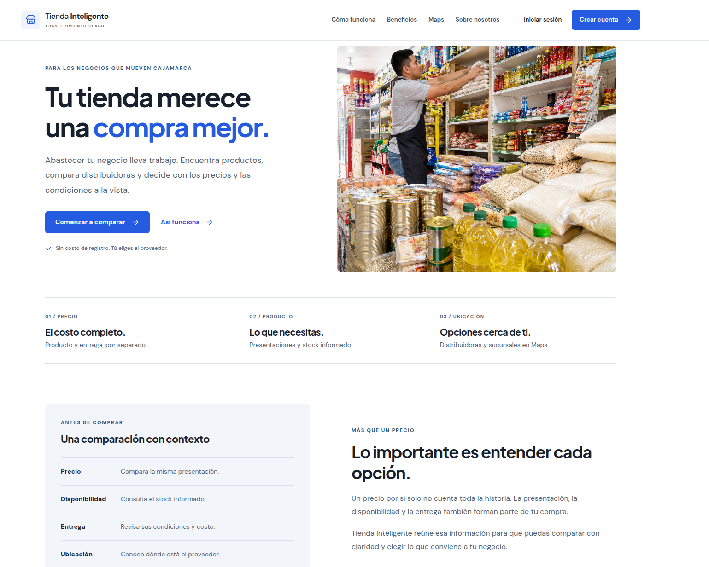
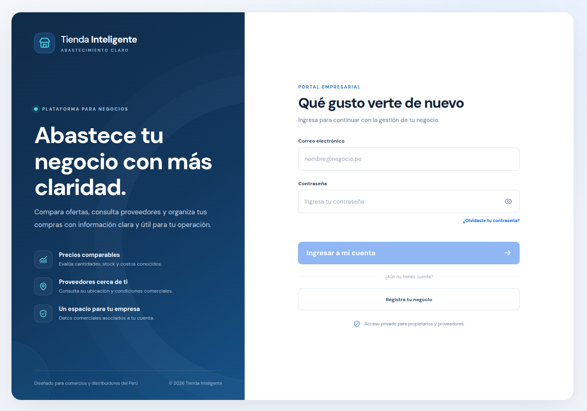
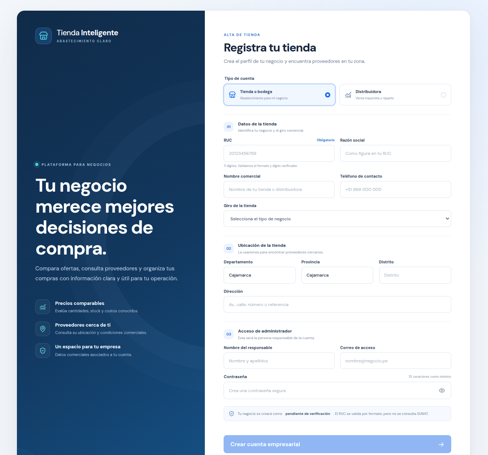
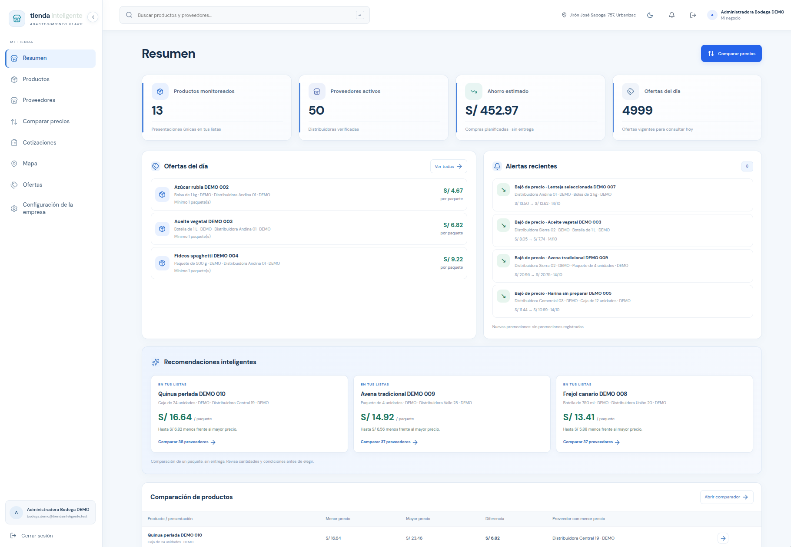
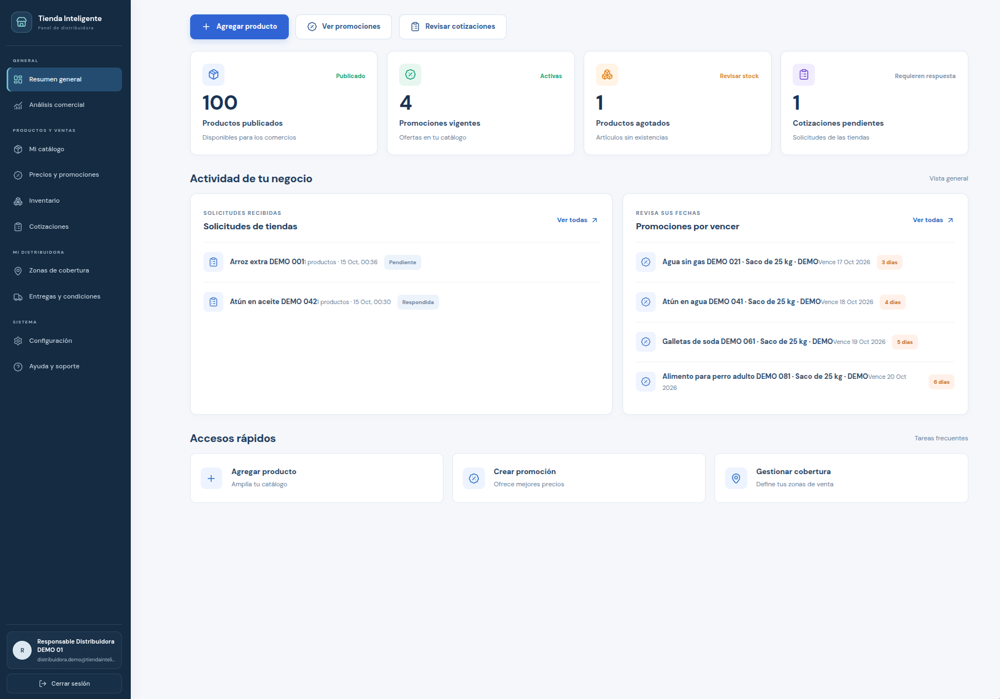

# Tienda Inteligente

**Abastecimiento claro para los negocios de Cajamarca.** Una plataforma que ayuda a bodegas a comparar productos, precios, disponibilidad y condiciones de entrega, y permite a distribuidores administrar su oferta comercial.

[Ver el proyecto en GitHub](https://github.com/Jerly404/Tienda-Inteligente) · [Cómo funciona](#cómo-funciona) · [Instalación](#puesta-en-marcha) · [Documentación](#documentación)

## La plataforma



Tienda Inteligente reúne información de productos y proveedores para que cada comercio pueda tomar decisiones de compra con más contexto. Los precios y condiciones dependen de la información publicada por los distribuidores.

## Experiencia por perfil

### Acceso a la plataforma

| Inicio de sesión | Registro de negocio |
| --- | --- |
|  |  |

### Paneles de gestión

| Tienda o bodega | Distribuidora |
| --- | --- |
|  |  |

## Qué puedes hacer

- **Tiendas y bodegas:** explorar productos, comparar ofertas por presentación, revisar proveedores y ubicaciones, organizar favoritos y listas, recibir alertas y solicitar cotizaciones.
- **Distribuidoras:** publicar productos, administrar precios y existencias, crear promociones, responder cotizaciones y gestionar cobertura y condiciones comerciales.
- **Administración:** revisar y gestionar cuentas, negocios y contenido de la plataforma desde un espacio con acceso restringido.
- **Mapa:** consultar sucursales verificadas con ubicación registrada mediante Leaflet y OpenStreetMap.

La comparación distingue precio del producto y costo de entrega cuando está informado. Una entrega sin costo conocido no se considera gratuita ni como un total confirmado.

## Tecnología

- **Web:** Angular 22 y TypeScript estricto.
- **API:** NestJS 11, REST, validación de DTO, Swagger y Helmet.
- **Datos:** PostgreSQL 16 con PostGIS y Prisma 6.
- **Acceso:** JWT y contraseñas protegidas con Argon2id.
- **Mapas:** Leaflet y teselas públicas de OpenStreetMap.

## Puesta en marcha

### Requisitos

Node.js 22.22.3+, 24.15+ o 26+, npm y Docker Compose. Las versiones de Node indicadas cumplen los requisitos de Angular 22.

### Instalar y ejecutar

Desde la raíz del repositorio:

```sh
cp .env.example .env
docker compose up -d db
npm install
npm run db:generate
npm run db:migrate
npm run dev
```

La aplicación web queda en <http://localhost:4200>. La API está en <http://localhost:3000/api>, su documentación Swagger en <http://localhost:3000/api/docs> y el estado del servicio en <http://localhost:3000/api/health>.

### Crear el primer administrador

No existe una cuenta administrativa predeterminada. Configura `ADMIN_EMAIL`, `ADMIN_NAME` y `ADMIN_PASSWORD` en el entorno local y ejecuta:

```sh
npm run admin:create
```

La contraseña debe tener al menos 14 caracteres. El comando solo permite crear el administrador inicial; no reemplaza una cuenta existente. No publiques credenciales ni las guardes en el repositorio.

### Datos de demostración (opcional)

Para cargar datos ficticios de desarrollo, activa `DEMO_SEED=true` en `.env` y ejecuta:

```sh
npm run db:seed
```

Esto carga 20 productos, 5 categorías y 60 ofertas de 3 proveedores de prueba. También hay un escenario visual más amplio:

```sh
npm run db:seed:showcase
```

**Atención:** el escenario showcase vacía todos los registros de la base local `tienda_inteligente` antes de cargar datos de demostración. Úsalo solo en un entorno local descartable. Los nombres, ubicaciones, precios y cuentas de demo son ficticios; la contraseña compartida de demostración es `TiendaDemo#2026`.

## Comandos útiles

| Comando | Acción |
| --- | --- |
| `npm run dev` | Inicia API y aplicación web en modo desarrollo. |
| `npm run build` | Compila API y aplicación web. |
| `npm test` | Ejecuta las pruebas de la API. |
| `npm run db:generate` | Genera el cliente Prisma. |
| `npm run db:migrate` | Crea o aplica migraciones durante el desarrollo. |
| `npm run db:migrate:deploy` | Aplica migraciones existentes en despliegue. |

## Organización del código

```text
apps/
  api/                 API NestJS y persistencia Prisma
    src/core/          Autenticación y capacidades centrales
    src/modules/       Dominios de negocio de la API
    prisma/            Esquema, migraciones y datos de desarrollo
  web/                 Aplicación Angular
    src/app/features/  Funcionalidades públicas, acceso, tienda,
                       distribuidora y administración
    src/app/shared/    Componentes y utilidades compartidos
docs/                  Arquitectura, producto y comparación
  images/              Capturas de las pantallas principales
```

## Documentación

- [Despliegue gratuito y actualizaciones automáticas con Render y Neon](docs/despliegue.md)
- [Arquitectura y organización del código](docs/arquitectura.md)
- [Estado de implementación y límites](docs/estado.md)
- [Implementación integrada](docs/implementacion-maestra.md)
- [Algoritmo de comparación](docs/algoritmo-comparacion.md)
- [Espacio de trabajo de tienda](docs/buyer-workspace.md)

## Alcance y configuración segura

Las distancias mostradas son en línea recta. El usuario debe confirmar las compras reportadas; no son órdenes de compra ni comprobantes fiscales. La validación del RUC comprueba formato y dígito verificador, pero todavía no consulta SUNAT. Las notificaciones por correo y WhatsApp no están integradas.

Antes de desplegar, configura un `JWT_SECRET` aleatorio y de alta entropía, y limita `WEB_ORIGIN` al origen de tu aplicación. No uses en producción valores de `.env.example` ni las cuentas de demostración. `.env` contiene configuración privada y no debe subirse al repositorio.
