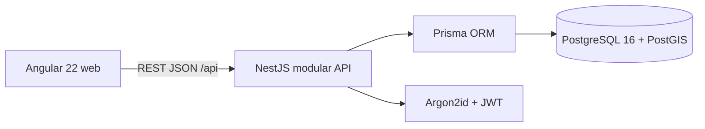
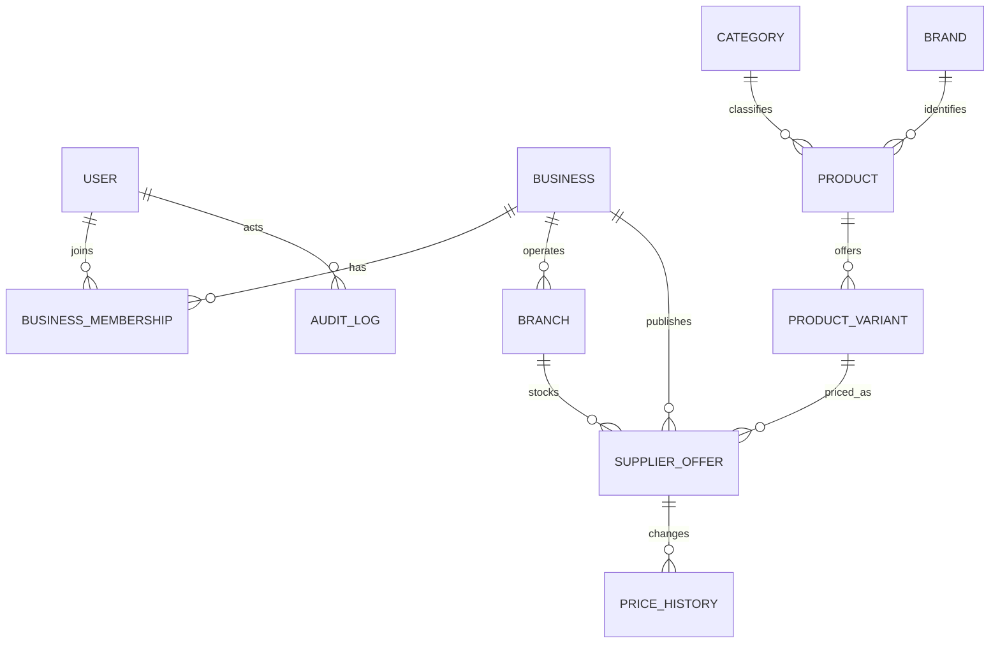

# Arquitectura

## Componentes



La aplicación se despliega como un monolito modular: NestJS agrupa autenticación, catálogo, negocios, ofertas, comparación y administración. Angular solo recopila preferencias y presenta resultados; el backend filtra ofertas y calcula precios/rankings. Prisma lleva las relaciones transaccionales. Las coordenadas se guardan como decimal en esta primera etapa y el cálculo de distancia usa Haversine; PostGIS queda habilitado en la base para consultas espaciales futuras.

## Organización del código

El repositorio conserva el monorepo `apps/web` + `apps/api`. Dentro de cada aplicación se organiza por funcionalidad y responsabilidad. Los nombres de carpetas usan inglés para seguir las convenciones del código: `store` es tienda, `supplier` es distribuidora y `admin` es administración.

### Frontend Angular

```text
apps/web/src/
├── app/
│   ├── app.component.ts          # Solo el contenedor raíz
│   ├── app.routes.ts             # Entradas de las áreas y redirecciones
│   ├── core/
│   │   ├── auth/                # Sesión, guards e interceptor
│   │   └── location/            # Estado de ubicación usado por varias pantallas
│   ├── shared/
│   │   ├── maps/                # Mapa y marcadores reutilizables
│   │   ├── pages/               # Página informativa usada en público y tienda
│   │   └── styles/              # Estilos base comunes de paneles
│   └── features/
│       ├── public/              # Sitio público: layout, páginas y CTA
│       ├── auth/                # Pantalla de acceso y registro
│       ├── store/               # Tienda: layout, data-access y páginas
│       │   └── pages/
│       │       ├── dashboard/
│       │       ├── catalog/
│       │       ├── comparison/
│       │       ├── shopping-lists/
│       │       ├── settings/
│       │       └── tools/
│       ├── supplier/            # Distribuidora: rutas, página y estilos propios
│       └── admin/               # Administración: rutas, página y estilos propios
└── styles/                      # CSS global y temas, en su orden de carga original
```

Cada área declara su archivo `*.routes.ts` y se carga con `loadChildren`. Se conservan las URL `/app`, `/proveedor`, `/admin`, `/login` y las rutas públicas, junto con los guards de sesión y rol. El componente raíz ya no contiene los layouts público y de tienda. Los estilos exclusivos de distribuidora y administración viven junto a sus componentes; los estilos base reutilizables están en `shared/styles`.

### Backend NestJS

```text
apps/api/src/
├── main.ts
├── app.module.ts                # Composición de módulos y configuración global
├── core/auth/                   # Autenticación, JWT y autorización
├── infrastructure/database/     # DatabaseModule y único proveedor PrismaService
├── prisma/                      # Comando de creación del administrador
└── modules/
    ├── store/                   # StoreModule: dashboard, listas y herramientas buyer
    ├── supplier/                # SupplierModule: negocio, ofertas, inventario y promociones
    ├── admin/                   # AdminModule: usuarios, negocios y catálogo administrativo
    ├── businesses/              # Negocios y reglas de cobertura compartidas
    ├── catalog/                 # Consulta del catálogo
    ├── comparison/              # Motor de comparación compartido
    ├── quotations/              # Cotizaciones entre tienda y distribuidora
    ├── geocoding/               # Búsqueda geográfica
    ├── configuration/           # Configuración pública
    └── health/                  # Estado del servicio
```

Cada dominio registra sus controladores y servicios en su propio módulo. `DatabaseModule` comparte una única instancia de Prisma; `AuthModule` exporta los guards. Los módulos consumidores importan los servicios compartidos mediante los módulos que los exportan. Los DTO de administrador y distribuidora están separados. Las pruebas `*.spec.ts` permanecen junto al código que verifican. El esquema, migraciones y seeds continúan en `apps/api/prisma`.

### Reglas para extender la aplicación

- Una pantalla exclusiva de un rol se agrega en su `features/<área>/pages`, con su plantilla y estilos. Sus rutas pertenecen al archivo de rutas de esa área.
- Los servicios de datos exclusivos de tienda pertenecen a `features/store/data-access`; los de otras áreas se agregan dentro de su propia área cuando se necesiten.
- `shared` contiene elementos realmente utilizados por varias áreas. No debe importar pantallas de `features`.
- Los módulos de tienda, distribuidora y administrador no importan implementaciones de otro rol. Las reglas comunes se ubican en módulos de dominio como negocios, comparación o cotizaciones.
- `core` contiene servicios transversales; `infrastructure` se ocupa del acceso técnico a datos. No colocar lógica comercial en el módulo raíz.
- Los estilos globales heredados siguen agrupados en `src/styles` para conservar la cascada. Los nuevos estilos exclusivos de una pantalla deben ir junto a su componente.

Validación: `npm run build` y `npm test`. El arranque de desarrollo sigue siendo `npm run dev`; no cambia la base de datos ni requiere migraciones por esta reorganización.

## Datos principales



Los montos se almacenan como `Decimal(12,2)` y las cantidades como `Decimal(12,3)`. Cada oferta indica PEN y una única variante de catálogo. Los eventos administrativos registran actor, objeto, acción y detalles.

## Límites de confianza

- `JwtAuthGuard` valida Bearer JWT; `AdminGuard` restringe administración al rol ADMIN.
- Los cambios de negocio requieren una membresía propia con permiso OWNER/MANAGER.
- Sucursales y ofertas se verifican contra el negocio de la ruta para bloquear referencias cruzadas.
- El catálogo público y el comparador solo incluyen proveedores en estado VERIFIED.
- No existe todavía refresh token, revocación inmediata de JWT ni limitador de solicitudes.

## Configuración

La API lee `.env` desde la raíz al ejecutarse como workspace. Prisma utiliza los scripts raíz, que cargan `.env` antes de migrar, generar el cliente, crear el administrador o cargar DEMO. Compose inicia únicamente PostgreSQL/PostGIS; web y API se ejecutan en Node durante desarrollo.
